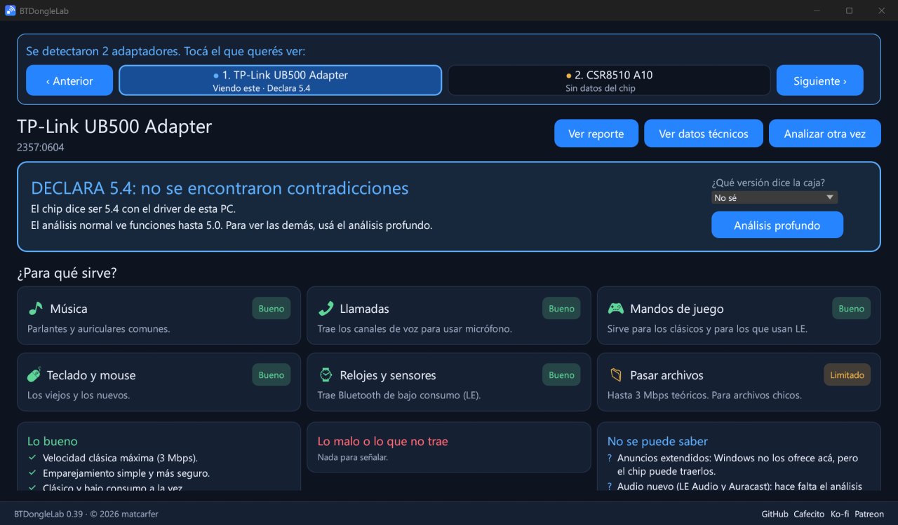
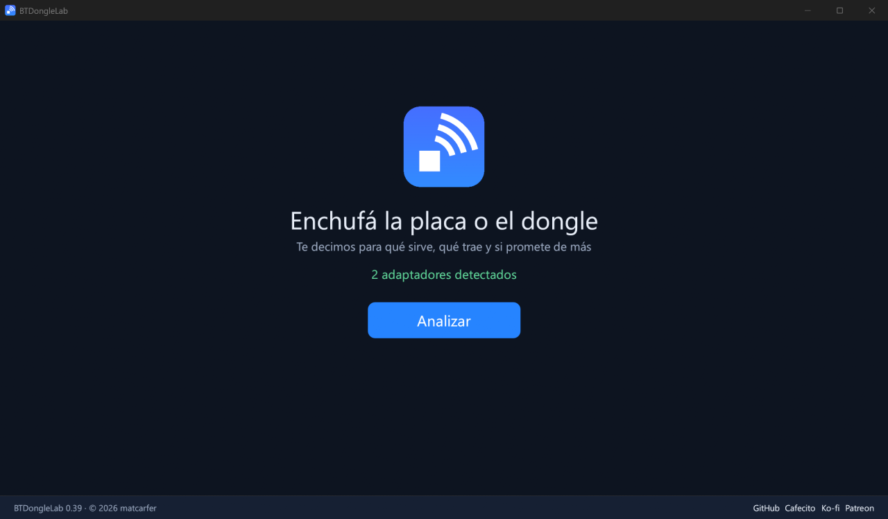

<h1 align="center">BTDongleLab</h1>

<h2 align="center"><a href="https://github.com/matcarfer/BTDongleLab-Windows/releases/download/v0.39/BTDongleLab_v0.39.exe">⬇ Download EXE</a></h2>

  <a href="README.md">Español</a> · <b>English</b>  
Analyzes your Bluetooth dongle or card: what it has, what it is good for 
and whether it promises more than it reports. 
<b>Tested on Windows 11. The program is in Spanish.</b>

   
  

**How to use:** plug the dongle in, open the program and click **Analizar**. No installation. It saves one `.html` report and one `.log` per dongle in its folder.

> Reports include the MAC address and other identifiers: check them before sharing.

Deep analysis (Análisis profundo)

Reads the chip's full list of LE features. It asks for administrator rights and drops Bluetooth for a few seconds: Bluetooth controllers, keyboards and headphones disconnect. Leave only one adapter plugged in. It does not change the driver or firmware.

What the result means

- The version a chip reports depends on the firmware loaded by the driver: it can change on another system.
- Many features are optional: not seeing them does not prove a false claim.
- "Probable clon" (likely clone) and "No cumple" (does not match) apply to the unit and driver measured.
- It does not measure range or antenna quality.

If Windows or the antivirus warns you

It is not code-signed. Choose **More info → Run anyway**, only if you downloaded it from this repo.

  <a href="https://cafecito.app/matcarfer">☕ Cafecito</a> · <a href="https://ko-fi.com/matcarfer">☕ Ko-fi</a> · <a href="https://www.patreon.com/matcarfer">❤ Patreon</a> 
  <a href="https://github.com/matcarfer/biblioteca/blob/main/README.en.md">📚 Software library</a>

---

Free, closed source. Do not redistribute: share this link. No warranty, no affiliation with manufacturers. <a href="LICENSE.en">License</a> · <a href="PRIVACY.md">Privacy</a> · <a href="TERCEROS.txt">Third parties</a>
