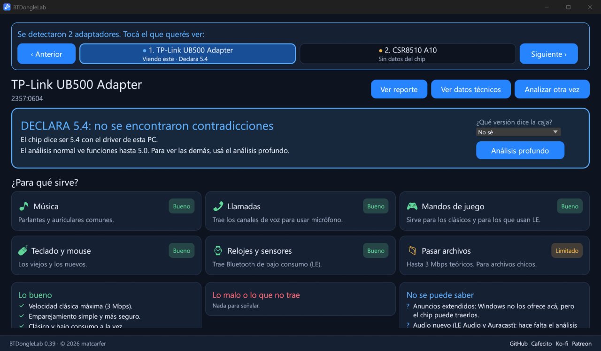
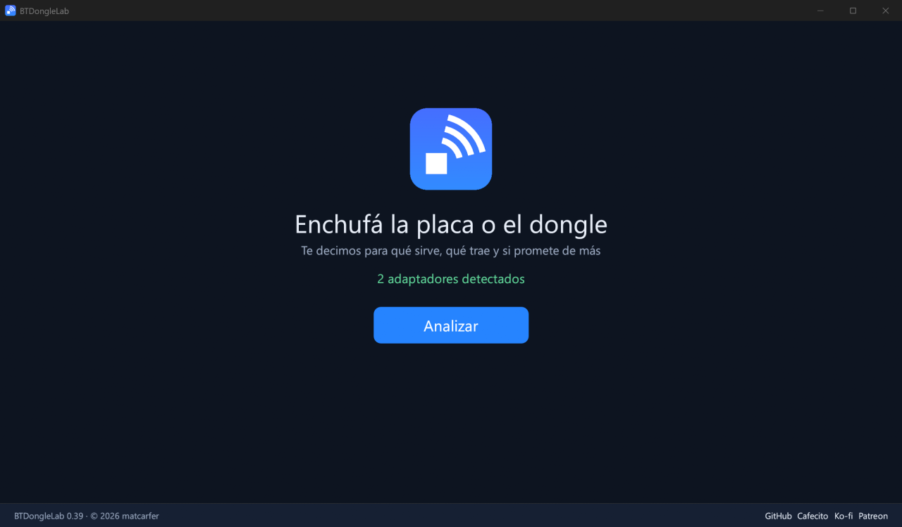

<h1 align="center">BTDongleLab</h1>

<h2 align="center"><a href="https://github.com/matcarfer/BTDongleLab-Windows/releases/download/v0.39/BTDongleLab_v0.39.exe">⬇ Descargar EXE</a></h2>

  <b>Español</b> · <a href="README.en.md">English</a>  
Analiza tu dongle o placa Bluetooth: qué trae, para qué sirve 
y si promete más de lo que declara. 
<b>Probado en Windows 11.</b>

   
  

**Cómo se usa:** enchufá el dongle, abrí el programa y tocá **Analizar**. No se instala. Deja un reporte `.html` y un `.log` por dongle en su carpeta.

> Los reportes incluyen la MAC y otros identificadores: revisalos antes de compartirlos.

Análisis profundo

Lee la lista completa de funciones LE del chip. Pide administrador y corta el Bluetooth unos segundos: mandos, teclados y auriculares Bluetooth se desconectan. Dejá conectado un solo adaptador. No cambia el driver ni el firmware.

Qué significa el resultado

- La versión que declara un chip depende del firmware que carga el driver: puede cambiar en otro sistema.
- Muchas funciones son opcionales: no verlas no prueba que mienta.
- "Probable clon" y "No cumple" valen para la unidad y el driver medidos.
- No mide alcance ni calidad de antena.

Si Windows o el antivirus avisa

No está firmado. Elegí **Más información → Ejecutar de todas formas**, solo si lo bajaste de este repo.

  <a href="https://cafecito.app/matcarfer">☕ Cafecito</a> · <a href="https://ko-fi.com/matcarfer">☕ Ko-fi</a> · <a href="https://www.patreon.com/matcarfer">❤ Patreon</a> 
  <a href="https://github.com/matcarfer/biblioteca">📚 Biblioteca de software</a>

---

Gratis, de código cerrado. No redistribuir: compartí este link. Sin garantía ni afiliación con los fabricantes. <a href="LICENSE">Licencia</a> · <a href="PRIVACY.es.md">Privacidad</a> · <a href="TERCEROS.txt">Terceros</a>
